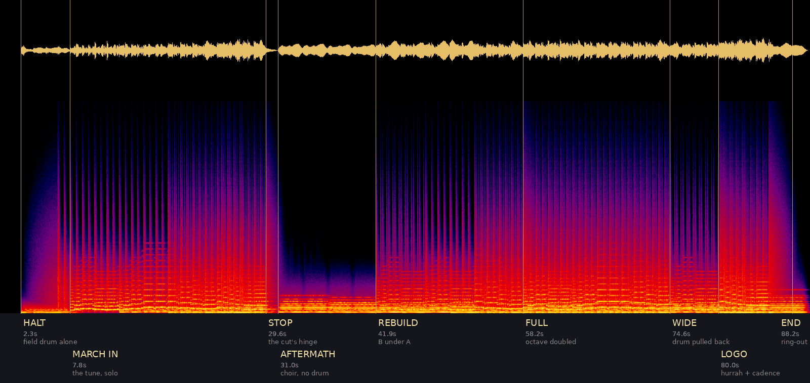

# The trailer

Eighty seconds, for the Steam page, the itch page and YouTube. One joke,
told straight.

## The joke

It opens as a prestige grand strategy trailer — gold on black, portentous,
sweeping claims over a lamplit map — and then every claim is undercut by what
the game actually does. The humour is not jokes written on top of the footage.
It is the footage, captioned honestly. The game is genuinely large and
genuinely unfinished and its AI is genuinely not very good, and saying so in
the voice a publisher uses for "a world of endless possibility" is the whole
bit.

It has to be TRUE to be funny. The moment a caption oversells, the trailer
becomes the thing it is making fun of, and the ending — which is sincere —
stops working.

Three things only this game can end on, and they are saved for last: it is
played by a fruit fly, it runs on TempleOS, and it costs nothing.

## The cut

Times are where a beat LANDS. The authoritative version is the SHOTS table in
`tools/trailer_build.py`; this is the intent it was written from. 40 shots,
90 seconds, mean shot length 2.25 s.

| Time | On screen | Caption |
|---|---|---|
| 0:00 | Black, then the Modern Day map fades up under a slow push | — |
| 0:04 | Push to central Asia | A GRAND STRATEGY GAME |
| 0:08 | The world, then one province's panel | 1,641 provinces |
| 0:11 | **The globe, in space. Then the globe at night.** | — |
| 0:15 | The research tree, two angles | 86 technologies |
| 0:18 | Doctrines, then districts, then monuments | 59 doctrines |
| 0:22 | Armies, orders, the troop map | Your orders are carried out |
| 0:27 | **A rebellion spawns. Two closes, no caption.** | — |
| 0:30 | Hold. Music stops dead. Pull back to the whole world. | By someone |
| 0:33 | Economy, then goods, then the factories | Industry you cannot afford |
| 0:38 | A portrait, then a country at war with its own ally | Allies who will not come |
| 0:41 | Europe on turn three, then the Declare War button | A war you started on turn three |
| 0:44 | **The advisor, answering** | Advice, confidently given |
| 0:48 | South America gone, then the far east | A country that no longer exists |
| 0:51 | The Atlantic full of ships, then the whole world, sped up | It is played by |
| 0:55 | The tutorial, talking to you | you |
| 0:58 | The multiplayer lobby | your friends |
| 1:00 | **The fly at its desk, brain lit beside it** | and a fruit fly |
| 1:05 | Hold on the brain. Let it sit. | 138,639 neurons. It is not good at it. |
| 1:10 | A third angle on the fly, silent | — |
| 1:14 | Four marks, one at a time, each word lighting as it lands | Windows. macOS. Linux. A browser tab. |
| 1:19 | **The TempleOS build, palettised, in the map** | And an operating system one man wrote for God. |
| 1:23 | Gold wordmark on the sunken ground | Free. All of it. |
| 1:26 | | opendoctrines.pages.dev |

The two held beats — 0:30 and 1:05 — are the trailer. Do not cut inside them.

## Why 40 shots and not 21

The first assembly had 21, and eight were the identical world view at the
identical scale. Thirty seconds of one picture with things moving in it, which
a viewer reads as one long shot. Three rules fixed it:

**No two adjacent map shots share a scale.** `geo(lon, lat, span)` names a crop
in degrees — the map is equirectangular at 2:1, so a degree is the same number
of pixels both ways. `EUROPE`, `SASIA`, `SAMER`, `ATLANT`, `FAREAST` are
115-165 degrees wide against the world's 360, and `WORLD` is now spent only on
the establisher, the full stop, and the release.

**It is not all map.** The globe, the tech tree, districts, monuments, goods,
the sector taxes, the diplomatic actions, the advisor answering a question, the
tutorial and the multiplayer lobby are all in it now. None of them is captioned
as a feature: each sits under a caption that was already there, which is how
the trailer shows what the game is without becoming the feature list this
document forbids. Goods lands under "Industry you cannot afford", the Declare
War button under "A war you started on turn three", the tutorial under "you".

**One caption, two angles.** Every deadpan beat is two short shots rather than
one long one. Mean shot length went 4.0 s to 2.25 s without moving a music cue,
because the section boundaries the score depends on did not move.

## The plates

`tools/screenshots.sh` photographs 123 screens of a SIMULATED world in a
scratch data directory, so re-running it gives the same kind of picture rather
than whatever was on this machine. The ones the trailer uses are copied into
`docs/trailer/assets/plates/` so a build does not depend on `/tmp`.

Three traps in that set, all of which shipped into a cut before being caught:

- **Names do not mean what they look like.** The tour's `world-map.png` is the
  PAUSE MENU. `docs/img/world-map.png` is the world map. They are different
  pictures with the same filename in different directories -- which is exactly
  why this one came back: copying a fresh tour's output wholesale into
  `assets/plates/` overwrote the good plate with the menu, and the cut
  captioned it "1,641 provinces" for the second time. The tour's screen now
  lives beside it as `pause-menu.png`, under the name it deserves. Before
  copying a new tour in, DIFF it against the plates already there and look at
  what changed; a contact sheet will not catch it, because dark menu text on a
  dark map reads as "a map" at thumbnail size. `province` (the tour's is a
  regional view, not the world) and `monuments-map` (keyboard, below) need the
  same exclusion.
- **Some shots carry a touch keyboard.** `monuments-map` and `monuments-globe`
  are the on-screen-keyboard variants, and half the frame is keys.
- **`claims-uk` is in Ukrainian**, because it is the localisation shot. There
  is no English claims screen in the tour.

And one structural fact that shapes every crop: the tour photographs ONE world
from ONE camera, so every in-game plate shares the same West African coastline.
A gentle crop leaves a dozen shots that are the same picture with different
furniture on it. The fix is `zoom` — a real punch-in onto the panel, so the
shot is the goods table or the Declare War button rather than the map behind
it. The plates are 1600x900 and that is hardcoded in the tour
(`Game_Screenshots.cpp`), so zoom stays at or under 2.4.

## The look

| | |
|---|---|
| Frame | 2.39:1, letterboxed into a 1920x1080 file |
| Ground | `#090B11` — the site's `--sunken`, not black |
| Text | `#E8E4DA` — warm, "this is a paper-and-maps game" |
| Accent | `#C9A227` — the gold, used sparingly and never on two things at once |

Captions are the game's own font, left-aligned, held long enough to read twice,
and they FADE rather than appear — the plan says the type does not move, which
a fade is not. No motion graphics, no whoosh, no lens flare. The map moves; the
type does not.

**Transitions are chosen, not defaulted.** 39 straight cuts in a row read as a
slideshow. `into` on each shot picks one of four, and the final assembly is a
single `xfade` chain rather than a concat:

| | |
|---|---|
| `cut` | a true cut (two frames of overlap, invisible) — 14 of them, all in the deadpan stretch, because deadpan is cuts |
| `mix` | a dissolve, for two shots of the same subject or the same place |
| `dip` | through black, for a section break, where a dissolve would lie about the two sides being continuous |
| `smear` | a dissolve through motion, between two unrelated places |

Each transition is CENTRED on the incoming shot's slot start, so the outgoing
shot gives up half of it and the incoming shot the other half. That is what an
editor means by a dissolve ON the beat, and it is why adding transitions did
not move a single music cue. Shots are rendered longer than their slot by the
widest transition so a dissolve has material to cross over instead of freezing.

Five things make it read as shot rather than assembled, and they are all in
`trailer_build.py`:

- **Scope.** The picture is 2.39:1 and the file is 16:9. Cropping 156 rows off
  a world map sounds like damage and is the opposite: the bottom eighth of
  every map layer is the Antarctic ice shelf drawn as flat grey, and it was the
  brightest thing on screen in half the shots.
- **A grade.** Raw game output is pure black behind saturated province colour,
  which is not "a lamplit map table". The blacks are lifted INTO the sunken
  blue, the highlights pulled toward the gold, saturation down a tenth, with a
  vignette and fine grain over the print.
- **Per-shot exposure.** One look, but not one exposure: `research.png` and
  `policies.png` average 12.7 and 15.3 against the world map's 42.5, and a
  curve that lifts a lit map's blacks pushes those two further down. They carry
  a gamma lift. Gamma ONLY — a flat brightness offset lifts the toe as well and
  the result is milky, which trades away the deep black the grade exists for.
- **Eased moves.** Raised-cosine, so a push accelerates away from rest and
  settles into it. A linear ramp starts and stops dead and reads as a crop
  animating. The two held beats pull OUT rather than in, so not everything
  drifts the same way.
- **Punch-ins, not crops.** `zoom` scales a plate past the frame and takes a
  window around the focus point, which is what turns a screenshot of the whole
  interface into a shot of one panel. Aiming it is per-plate work and five of
  them landed on empty sea or an unlit panel the first time; the fastest way to
  aim is to render the plate with a 0.1 grid over it and read the coordinates
  off.

## Music

Original, written for this. ~88 BPM, D minor, trip-hop: a dusty broken beat,
sub bass, a hypnotic two-bar ostinato on something plucked and filtered, and a
wordless vocal pad used as texture rather than melody.

**On the reference.** The brief is Phantogram's *Black Out Days* — take its
MOOD: sparse, hypnotic, patient, a low vocal sitting under the beat rather
than over it, and a drop that removes almost everything. Take none of its
material: no melodic quotation, no interpolated hook, no lyric, nothing that
could be matched. A trailer on Steam and YouTube runs through content ID, and
a track that merely resembles a well-known song in genre is fine while one
that reuses its hook is a claim on the video. Write the ostinato from scratch
in a different interval pattern and the resemblance stays where it belongs.

Cue sheet, mapped to the cut above:

| Time | What the music does |
|---|---|
| 0:00 | Ostinato alone, far back, filtered almost shut |
| 0:08 | Filter opens. Sub bass enters on the first caption |
| 0:21 | Drums. The only place anything approaches triumphant |
| 0:28 | **Everything stops.** One reverb tail over the rebellion |
| 0:31 | Beat returns halved, flat, no bass — the honest stretch |
| 0:47 | Rebuild. Bass back |
| 0:57 | Strip to the ostinato again for the fly |
| 1:07 | Full, warm, resolved — this part is sincere |
| 1:19 | Tail out under the URL |

## The march (for the Steam cut)

The trip-hop score above belongs to the 90-second cut that exists. The Steam
revamp replaces it, because the verdict on it was "way too repetitive, there is
no action at all, and it looks so detached from reality" -- and the first two
thirds of that are a fair description of one eight-note ostinato held for a
minute and a half. A march fixes repetition by construction: it has strains, a
refrain, and somewhere to go.

**The tune is "When Johnny Comes Marching Home", and the arrangement is ours.**
That split is the whole point. Remixing a known march the way Hearts of Iron
did is a content-ID problem before it is a musical one: the tune may be ancient
and the *recording* and *arrangement* you are thinking of are not. So:

| | |
|---|---|
| Melody | O'Neill's *Music of Ireland* (1903) **#468** — printed there as "Johnny Fill Up the Bowl" / "Johnny, I Hardly Knew You" / "When Johnny Comes Marching Home". 6/8, A minor, 16 bars. |
| Cross-checked | O'Neill's #69 (the 24-bar Irish air) and the Mandozine TOW setting, which agree note for note across these 16 bars |
| Copyright | Gilmore's words are 1863, O'Neill's print is 1903 — both long expired |
| Everything else | written in `tools/trailer_march.py`: chords, counter-lines, drum parts, voicing, orchestration |

Nothing is sampled and no MIDI is imported. The note list in that file *is* the
melody, transcribed from the ABC, and `tools/trailer_march.py --cues` prints
the form without rendering.

**Why this tune and not a generic march.** The Irish original is a lament for a
soldier who came home maimed; Gilmore's American refrain is a victory parade.
They are the same notes. A game whose whole argument is that the map rewards
things the people on it pay for does not get a better gift than a melody that
means both at once — so the arrangement plays it both ways, and the AFTERMATH
section is the parade handed to the choir with the drum taken away.

Form — eight sections, no two scored alike:

| Bar | Time | Section | Scoring |
|---|---|---|---|
| 0 | 0:02.3 | HALT | Field drum alone, crescendo roll. No tune yet |
| 4 | 0:07.8 | MARCH IN | The tune, one line. Strings at the second phrase, drum at the third |
| 20 | **0:29.6** | STOP | Everything out. One cymbal tail — the cut's hinge, preserved |
| 21 | 0:31.0 | AFTERMATH | The same phrases, choir only, augmented. The lament inside the parade |
| 29 | 0:41.9 | REBUILD | B strain in augmentation *under* the A strain — the one contrapuntal passage |
| 41 | 0:58.2 | FULL | Everything, octave-doubled |
| 53 | 1:14.6 | WIDE | Lead over choir, drum back to a rim pattern. Room to breathe |
| 57 | 1:20.1 | LOGO | The hurrah bars at full weight, then the cadence held under the wordmark |
| 63 | 1:28.2 | END | Ring-out |



**The grid still lands on 0:29.6.** Six-eight at dotted-quarter 88 gives a
1.3636 s bar, twenty bars is 27.2727 s, so the music starts 2.327 s in and bar
20 falls on 29.600 exactly. That is the *same clock* the trip-hop score used --
a 4/4 bar at 88 and two 6/8 bars at dotted-88 are the same length -- so the
existing cut's hinge survives the change of metre, on a finer grid.

**The refrain has holes in it, and they are free.** Bars 13-14 of the strain
are `e2z d2z | c2z B2z`: four rests where "Hur-rah! Hur-rah!" goes. The melody
leaves gaps for the drums to hit, which is exactly what a trailer wants and is
the reason this tune cuts better than the alternatives that were on the list.

**The instruments are stylised, not emulated.** Synthesis here is numpy-only
(no scipy in this repo, no sample library anywhere in it) and will not
convincingly impersonate an orchestra, so it does not try. The lead is a
harmonic stack with the two things that make brass read as brass -- a pitch
that scoops into the note, and a spectrum that opens as it gets louder -- not a
fake trumpet. The choir is formant-filtered tone and never carries the melody.
The field drum is the one voice that is genuinely close to the real thing. A
stylised score that knows what it is beats a symphonic one that does not.

## The Steam cut (the picture for the march)

`tools/trailer_march_cut.py`. 47 shots, 90.2 s, same grade and same scope frame
as the cut above; it reuses `trailer_build.py` wholesale and supplies its own
shot list, its own cards and its own score. Both cuts still build.

**The turn at 0:31 is the whole thing.** The march is sixteen bars played two
ways -- AFTERMATH is the lament, REBUILD is the parade -- and the picture does
the same with the *same numbers*:

| | AFTERMATH 0:31 | REBUILD 0:42 |
|---|---|---|
| 337 | provinces changed hands | |
| 780 | times they changed hands | **780 VICTORIES** |
| 87 | lost three quarters of their people | |
| 278,995,356 | gone from provinces just taken | |
| 948,780,090 | people who changed flag | **948,780,090 LIBERATED** |
| +76% | | **POPULATION +76%** |
| | | *EVERY FIGURE IS TRUE* |

Every figure comes from `docs/trailer/assets/toll.json`, which
`tools/trailer_toll.py` reads out of the first 120 turns of
`data/saves/Quick Start.odsv`. Nothing is invented on either side. That is the
argument: propaganda does not have to lie, it only has to choose which true
thing to print -- and a trailer that made the numbers up would be making a much
weaker point.

**What the save cannot tell you.** There is no casualty counter in `.odsv`, and
two obvious ways to fake one are both wrong. Summing every province's
turn-to-turn population decline gives 661 billion over the full Quick Start, in
a world of about six billion, because it is dominated by MIGRATION -- a person
leaving province A is a loss in A and a gain in B. And world population does
not fall during these runs, it rises. So the quoted figure is the narrowest
defensible one: population lost inside a province within six turns of that
province being taken. `trailer_toll.py`'s docstring carries the reasoning.

Related, and worth its own look: over 820 turns the population model runs away
completely (2.0bn -> far beyond plausible). Do not quote long-horizon saves, and
see the open migration-arithmetic item below.

**The cutting.** The note on the previous cut was that it felt "stuck on a map".
Most tour plates ARE the same West Africa map with a different panel over it, so
the fix is to punch into the PANEL and to break the montage with things that are
not maps: the globe, the charts, the TempleOS palette, the fly, and the cards.
The four quick cuts at 0:24 and again at 1:20 land on the march's hurrah rests
-- the melody leaves four holes and the picture uses them.

**The spectrogram.** `tools/trailer_march.py --egg` paints
`assets/egg-spectrogram.png` into the audio between 7.0 and 12.8 kHz during
AFTERMATH. It reads "OPEN DOCTRINES / hi data miners!" in any spectrogram view.

Placement is not arbitrary. The obvious hiding place is 16-20 kHz, where nobody
can hear it, and it does not survive: YouTube and Steam re-encode to AAC/Opus,
which low-pass around 15-16 kHz and spend no bits near the limit, so an
ultrasonic picture arrives as an empty band. And the LOUDEST section is the best
masking but the worst canvas -- the crashes fill that band with noise and the
letters cannot be read out of it. AFTERMATH has no drum at all by design and its
choir sits below 1 kHz, so the band is empty, the picture is legible, and there
is still music over it. It sits 38 dB under the music and does not move the
peak. Honest claim: masked, not inaudible.

## Motion, and why the cut stopped being a slideshow

The note on the first assembly of the Steam cut was that static images are not
cinematic -- which was fair, because a Ken Burns push on a screenshot is not
movement, it is a screenshot being cropped slowly. Seventeen of the forty-six
shots are now real footage.

**The map actually evolving.** `tools/trailer_timelapse.sh` drives
`--export-timelapse` over a whole save and writes `political-fast.mp4` and
`troops-fast.mp4`: 1920x832, one frame per turn, 820 turns of *Quick Start* in
19.7 seconds. The cut reads them through `shot_clip`'s existing `geo()` crops,
so a shot is written as "Eurasia, turn 200, drifting east".

Two traps are baked into that script because both cost an hour:

* **The GIF carries a per-frame delay.** `--export-timelapse` writes a GIF and
  ffmpeg honours its timing, so an 820-turn export decodes to SIX AND A HALF
  MINUTES with every frame repeated about fourteen times. Re-encode that
  straight and you get a file that looks like a still image. One frame in
  twenty is kept, which restores one turn per frame.
* **Antarctica is drawn flat grey** and is the brightest thing on the plate --
  on a dark trailer it reads as a light leak along the bottom edge. The crop to
  1920x832 removes it and lands on 2.31:1, close enough to the 2.39 picture
  that the shots barely scale.

**A 3-D shot this project owns.** `tools/trailer_blender.py` builds a room, a
desk, a monitor and a fly out of primitives and flies a camera through it into
the screen -- with the political timelapse playing ON the monitor, so the
thing the camera approaches is the game running. The old cut used two fly
plates whose origin nobody can now point at; that is tolerable for a README
image and not for a storefront, which is commercial use. Everything in this
scene is authored here, so there is no provenance question and no licence to
honour. Eevee renders it headless at about a third of a second a frame.

**And the stills that remain are no longer the same picture.** The tour takes
125 screens and only 28 were ever kept, so the cut had been drawing from a
narrow slice of what exists -- eleven of its twenty-four plates were the same
West Africa map with a different panel over it. The four hard cuts on the
hurrah rests now land on four different PALETTES: the globe's magenta resource
overlay, its red population overlay, an advisor portrait, and the map editor's
green. That, rather than a longer dissolve, is what stops a montage reading as
one screenshot held for ninety seconds.

**What is still one picture, and why that is the tour's fault not the cut's.**
`Game_Screenshots.cpp` picks ONE country (most provinces) and ONE province
(most populous) after loading, and `beginScreenshotTour` caches the flat
camera on the first map shot and restores it for every later one. So every
flat-map plate is framed identically by construction, and re-running the tour
with forty turns instead of twelve changes the world without changing the
frame. Fixing that means giving `struct Shot` its own framing and resolving a
spread of focus provinces after load -- a real change, in C++, not a change to
this cut.

## Delivering it to YouTube

`docs/trailer/assets/march-cut-youtube.mp4`, built from the assembly with the
VIDEO COPIED -- re-encoding a finished master only adds a generation of loss and
YouTube re-encodes it again at the other end anyway.

**The audio was already on target and that is worth knowing before touching it.**
The march measured -14.8 LUFS integrated against YouTube's -14, so there was
nothing to normalise; the only real defect was a true peak of -0.9 dBFS, which
is hot enough that a lossy re-encode's inter-sample peaks can cross 0 and clip
on some decoders. Streaming delivery wants -1.0 dBTP or lower.

**Do not let loudnorm pick its own mode here.** Asked for I=-14 it chooses
`dynamic`, which compresses -- and the hole at 0:29.6 is the entire point of
this score. Forcing `linear=true` with the target set to the measured value
makes the filter's only real job the peak limit:

| | before | after |
|---|---|---|
| Integrated | -14.8 LUFS | -13.7 LUFS |
| True peak | -0.9 dBFS | **-1.5 dBFS** |
| LRA | 5.4 LU | 4.4 LU |
| Drop into the STOP | 17.3 dB | **17.3 dB** |

The last row is the check that matters: the stop is exactly as deep as it was,
so the 1 LU of range that went is the limiter shaving crash transients and not
the music being squashed. At -13.7 YouTube will pull it ~0.3 dB, which is
inaudible and better than arriving quiet.

**Dark gradients are the real YouTube risk** for a cut graded this low -- they
band badly through VP9. The grain already in `PRINT` (`noise=alls=5:allf=t+u`)
is what prevents it, so that filter is load-bearing for delivery and not just a
look.

## The outro

`tools/trailer_outro.py`. The brief asked for "an end that animates into the
logo of Open Doctrines, with a background of changing wars", and named
Minecraft's channel outro -- the one where the logo assembles out of blocks.
The translation is obvious once stated: **this game's blocks are provinces**.

    python3 tools/trailer_outro.py                   # 9 s, 1920x1080, scored
    python3 tools/trailer_outro.py --alpha           # transparent .mov

675 map tiles fly in from outside the frame, land with an overshoot, and a gold
sweep crosses them left to right and converts them into the wordmark. The
political timelapse runs behind the whole thing, so the "changing wars" are a
real game rather than a loop of stock.

**The tile positions come from the logo, not from a copy of it.**
`assets/wordmark-gold.png` is sampled on a grid and every cell whose alpha is
mostly covered becomes a tile, so the outro cannot drift from the brand:
regenerate the wordmark and the outro follows.

**The colours are the game's**, sampled off the political plate -- saturated
pixels, quantised, most common first -- rather than chosen to look map-ish.

**The background is blurred, and that is a fix rather than a style.** The
timelapse draws armies and cities as small white squares which, at tile size,
are indistinguishable from tiles still in flight; a sharp background read as a
logo that never finished assembling. Three pixels of blur separates figure from
ground.

**The sting is the march's own ending**, cut from `march.wav` at 79.60-88.60
rather than written again. That lands the four hurrah hits at t=0.91, 1.59,
2.27 and 2.95 while the tiles are still flying, and the cadence at t=4.55 --
inside the gold sweep, which runs 3.78 to 5.58. The two were not tuned to each
other; they agree because both were built on the same grid.

Tiles are drawn as rotated POLYGONS, not rotated sprites: four corners through
a rotation matrix costs a fraction of a per-tile resample, which is the
difference between a minute's render and ten.

**A polygon from -h to +h covers 2h+1 pixels, not 2h.** Setting `half` to
cell/2 therefore drew an ELEVEN pixel tile on a ten pixel grid: every adjacent
pair overlapped by a pixel and fused into a blob, while isolated tiles stayed
discrete squares -- so the logo read as tiles of different sizes, which is
exactly what it was criticised for. `--gutter` (default 2) solves for the width
instead of halving the cell. Measured on the alpha render, every tile is now
8x8: 5,400 horizontal runs and 5,400 vertical runs, all of length 8, no fusing.

**The URL was a domain that does not exist.** Both this and the Steam cut's end
card said `open-doctrines.com`, which is NXDOMAIN; the site is
`opendoctrines.pages.dev`, which is what the older trip-hop cut had always
used. An end card's one job is leaving somebody able to find the game again, so
this was the most expensive kind of small bug.

IT IS NOW THE TRAILER'S ENDING. Shots 41-46 -- four hard cuts on the hurrah
rests, a settling world map and a six-second static logo -- are one shot:
`--raw --land 4.09 --url-at 5.60`, rendered at 1920x884 so the cut's own
FIT_CLIP, grade, vignette and grain are the only ones applied.

`--land` is why it works. The timings are absolute seconds, not fractions of
the clip, so the last tile arrives at t=4.09 of a shot that starts at 1:20.05
-- which is 1:24.15, which is the cadence. The four hurrah hits at 0.46, 1.14,
1.82 and 2.50 now land while the tiles are still in the air, so the drum drives
the assembly instead of cutting against it.

The wordmark measures dimmer inside the cut (mean 22.7 against the standalone's
36.4) and that is the vignette, not a problem: the 95th percentile is 149
against 151, so the gold itself is as bright as ever and only the surround has
gone down.

## What this needs that does not exist yet

1. ~~A 1920x960 timelapse.~~ **Done, and it was never missing.**
   `--export-timelapse` has been in `main.cpp` all along -- at the repo root,
   not under `src/`, which is why a search for callers of
   `exportTimelapseHeadless()` came up empty and this document originally
   called it a blocker. It is fully headless: no window, no display, no audio.

   ```
   build/OpenDoctrines.app/Contents/MacOS/OpenDoctrines \
       --export-timelapse "data/saves/Bench modern CHN (5).odsv" \
       out.gif 1920x960 --no-watermark
   ```

   Takes about two minutes and writes 721 frames. `population` or `troops` as
   a further argument renders those map modes instead. Then, because Steam and
   YouTube want video rather than a 102 MB GIF:

   ```
   ffmpeg -i out.gif -vf "fps=30,scale=1920:960:flags=lanczos,format=yuv420p" \
          -c:v libx264 -preset slow -crf 18 -movflags +faststart out.mp4
   ```

   113 MB becomes 11 MB at 58 seconds.

   **The save is `Bench modern CHN (5)`, and it was chosen by measurement.**
   All 692 saves in `data/saves/` were screened on the last turn's
   `conqueredProvincePrevOwner` and rebellion counts; the three best were
   rendered in full and compared frame by frame against turn 0, after a
   downsample that washes out the unit markers so the number counts territory
   and not blinking icons:

   | save | share of the map that changes hands by turn 720 |
   |---|---|
   | `Bench 1914 FRA (100)` | 8.4% |
   | `Bench modern CHN (36)` | 12.6% |
   | **`Bench modern CHN (5)`** | **15.3%, peaking at 16.1% on turn 432** |

   Nearly double the 1914 game, and the arc builds rather than settling early
   — CHN (36) is already consolidated by its midpoint and then sits still,
   which is the one thing a timelapse cannot survive. What CHN (5) actually
   shows: Russia losing its entire far east, Brazil eaten, the Sahel going to
   one power, Greenland changing hands, and a few hundred ships crossing the
   Atlantic at once in the middle of it. Cutting at turn ~500 keeps the arc
   strictly rising if 58 seconds is more than the edit wants.

   Four clips exist, frame-aligned, so the edit can cut between map modes on
   the same turn: political, `population`, `troops` (all from
   `Bench 1914 FRA (100)`) and the political collapse above.
2. **Screen capture of real play** — panels, orders, a battle resolving. The
   timelapse cannot show the interface, and this is the part a player
   recognises. Has to be recorded by a person. The cut currently stands in the
   docs screenshots with a slow push on each, which carries the pacing but not
   the motion.
3. ~~**The music.**~~ **Written and rendered**: `tools/trailer_music.py`,
   `docs/trailer/assets/score.wav`. Synthesised from nothing -- no sample, no
   loop pack, no MIDI import -- so the content-ID problem the spec worries about
   cannot arise: there is no borrowed material to match. Karplus-Strong for the
   plucked ostinato, detuned saws through a low-pass for the wordless pad, a
   Schroeder reverb for the one tail that has to carry the stop.

   **The grid is offset on purpose.** The cut's hinge is the full stop at 0:28,
   and a bar edge has to land on it exactly or the joke falls on an off-beat.
   At 88 BPM a bar is 2.7272 s, which does not divide 28.0, so the whole track
   starts 0.727 s late and bar 10 lands on 28.000. The two cues after it that
   matter -- the return at 0:31 and the rebuild at 0:47 -- land within a tenth
   of a second.

   Measured against the cue sheet, per band, in dB:

   | section | 30-120 Hz | 300-2.5k | 4-12k |
   |---|---|---|---|
   | 0:03 filtered almost shut | 7 | 10 | -22 |
   | 0:12 open, sub in | 53 | 20 | -1 |
   | 0:23 drums | 53 | 18 | 9 |
   | **0:28 the stop** | **28** | **-5** | **-11** |
   | 0:33 halved, no bass | 45 | 17 | 4 |
   | 0:59 ostinato alone | 29 | 13 | -15 |
   | 1:10 full | 56 | 18 | 11 |

   That is the arrangement doing what the sheet says. It is NOT a judgement of
   whether it sounds good, which nobody has checked, because it was written by
   something that cannot hear it. Listen before shipping.
4. **A voice, or none.** Written for captions, deliberately: no narration to
   record, no translation to commission, and it works muted, which is how it
   will mostly be seen on a storefront.
5. **One shot that cannot be made here: 0:51, "you".** A person at a keyboard.
   It renders as a slate that says PLACEHOLDER in gold, on purpose — a missing
   shot that reads as finished is how a trailer ships with a hole in it.

## Building it

`tools/trailer_build.py` holds the cut above as data and renders it. The table
in the script and the table in this document are the same table; change one and
change the other.

```
python3 tools/trailer_assets.py            # wordmark + platform marks, once
python3 tools/trailer_build.py             # all 21 shots, then concat
python3 tools/trailer_build.py 9 12        # rebuild two shots, reuse the rest
```

Every shot renders to its own 1920x1080 h264 segment with identical encoder
parameters, so the concatenation is a stream copy — no re-encode, no generation
loss, and one shot can be redone without touching the other twenty. 83 seconds,
about 20 MB, under a minute to build.

Decisions the script makes that are not obvious from the cut:

- **The marks are not drawn.** The platform icons are lifted from
  `packaging/web/site/download.html`, which already carries them under their
  own licences, and the browser mark is Lucide's `app-window`, vendored in
  `docs/trailer/vendor/`. `trailer_assets.py` asserts the page still has seven
  icons, so a new platform on the download page stops the build rather than
  silently relabelling every mark.
- **The end card is the name, not the monogram.** `art/logo/od-mark.svg` is
  `O.D.`, which is a favicon. The card at 1:16 exists so somebody can find the
  game again, and a monogram cannot do that, so the full wordmark is generated
  from `make_logo_svg.py` with the same font. The monogram returns at 1:19,
  under the URL, where the name has already been read.
- **Captions carry their own scrim.** They land over a lit map, and the economy
  screenshot has pale text exactly where they sit. The gradient is baked into
  the caption PNG, so no shot needs a second filter pass.
- **Stills are fitted, not filled.** The TempleOS build is 4:3 and was losing
  its menu bar and both poles to a crop before the fit was made explicit.
- **Captions are drawn with PIL, not `drawtext`.** They carry commas,
  apostrophes and newlines, and every one of those is a quoting bug waiting in
  a filtergraph string.

Assembly needs no editor. Adding the music is one more ffmpeg call.

## What it must not become

A feature list. The temptation is to add the map editor, the mod SDK, the
scenarios, multiplayer hosting, the benchmark. All of that is on the store
page. The trailer has one job: make somebody curious enough to click a free
game, and the fly does more of that than any feature.
